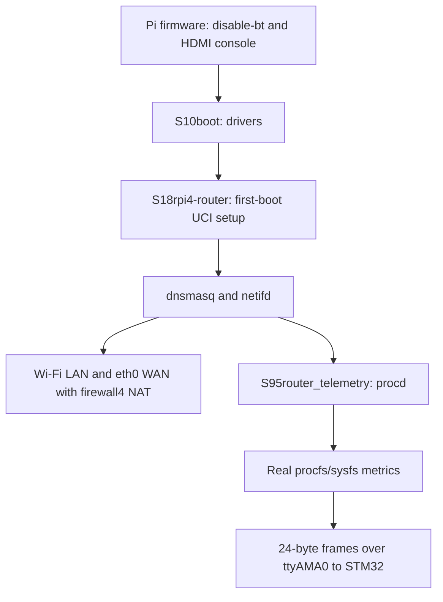

# Raspberry Pi 4 wireless router and UART telemetry

This OpenWrt 25.12.6 tree includes two local packages adapted from
`openwrt_uart_router_files_REISSUED/router_telemetry.patch` and
`wireless_router.sh`. The MCU project is not modified.

## Result

- `eth0`: WAN, IPv4 DHCP client. Connect to an upstream router/network whose
  subnet differs from `192.168.88.0/24`.
- Wi-Fi: `OpenWrt-Pi4B`, WPA2-PSK, Taiwan (`TW`), 2.4 GHz channel 6 / HT20.
  The local password is in `files/etc/config/rpi4_router`, ignored by Git.
- LAN: Wi-Fi-only `br-lan`, `192.168.88.1/24`, DHCP `.100` through `.199`,
  DNS through dnsmasq, IPv4 NAT and LAN-to-WAN forwarding through firewall4.
- Telemetry: `/usr/sbin/router_telemetry_sender`; `/dev/ttyAMA0`, 115200 8N1,
  once per second.
  It samples `br-lan`, `/proc/stat`, and `/proc/meminfo` and emits the existing
  STM32 24-byte version-1 protocol, sequence counter and CRC32.
- The router profile removes `console=serial0,115200` from the generated boot
  partition's `cmdline.txt`. `console=tty1`, root PARTUUID and rootwait remain.
  The existing `[pi4] dtoverlay=disable-bt` maps PL011 to GPIO14/15.

The setup service runs at S18, after S10boot loads drivers and before dnsmasq
(S19) and netifd (S20). It detects Wi-Fi configuration, validates the key,
backs up original UCI files to `/root/router-config-before-firstboot`, applies
router settings, and records `rpi4_router.main.configured=1`. Subsequent boots
preserve your UCI changes. A missing key or radio causes setup to exit without
reconfiguring the network; inspect `logread -e rpi4-router` and retry after
correcting the configuration.



## Build and output

The completed SDK/ImageBuilder build uses the matching official release
[SDK and ImageBuilder](https://downloads.openwrt.org/releases/25.12.6/targets/bcm27xx/bcm2711/).
Their SHA256 hashes are pinned and checked by the build script. The two local
packages are compiled from this repository; the kernel and other packages come
from the official 25.12.6 release. This is not a full kernel/toolchain source
rebuild.

```sh
./scripts/build-rpi4-router.sh
```

Outputs under `bin/targets/bcm27xx/bcm2711/`:

- `router_telemetry_sender`: deployable AArch64/musl ELF binary.
- `packages/router-telemetry-1.0-r2.apk` and `packages/rpi4-router-1.0-r1.apk`.
- `openwrt-25.12.6-bcm27xx-bcm2711-rpi-4-squashfs-factory.img.gz`:
  recommended fresh SD-card image for this configuration.
- ext4 factory and squashfs/ext4 sysupgrade images, manifests and SHA256 sums.

Logs: `logs/router-sdk-build.log`, `logs/router-image-build.log`.
Build caches and firmware outputs are ignored by Git. Images contain the
configured Wi-Fi password, so treat them as private artifacts.

Validation logs are in `logs/router-binary-validation.log`,
`logs/router-firstboot-validation.log`, `logs/router-service-validation.log`
and `logs/router-image-validation.log`. They cover AArch64 execution and frame
CRC32, real OpenWrt UCI configuration in an isolated QEMU environment, preserving
settings on a second boot, rejecting missing radio/invalid credentials, and
service startup while the LAN bridge is still absent. Radio discovery and
procd process registration are stubbed in those configuration tests; they do
not test actual Wi-Fi hardware or the UART wire.

For a clean checkout, create the ignored credentials overlay before building:

```sh
mkdir -p files/etc/config
cp package/network/config/rpi4-router/files/rpi4_router.config files/etc/config/rpi4_router
chmod 600 files/etc/config/rpi4_router
# Edit option key (8..63 printable ASCII characters), SSID and country as needed.
${EDITOR:-vi} files/etc/config/rpi4_router
```

To build the entire firmware from this OpenWrt source tree instead:

```sh
./scripts/feeds update -a
./scripts/feeds install -a
# The current .config is already prepared. For a clean checkout:
cp config/router/rpi4-router.config .config
make defconfig
make -j2 download
make -j2
```

The local packages install the init scripts, UCI files and binary themselves;
do not copy host executables into `files/usr/sbin`. Only credentials belong in
the overlay. Selecting `rpi4-router=y` activates the image boot-argument change;
ordinary Pi images without this package retain their serial console.

## Installed paths

| Source | Firmware path |
| --- | --- |
| `package/utils/router-telemetry/src/` | `/usr/sbin/router_telemetry_sender` |
| `package/utils/router-telemetry/files/router_telemetry.init` | `/etc/init.d/router_telemetry` |
| `package/utils/router-telemetry/files/router_telemetry.config` | `/etc/config/router_telemetry` |
| `package/network/config/rpi4-router/files/rpi4-router.init` | `/etc/init.d/rpi4-router` |
| `package/network/config/rpi4-router/files/rpi4-router-setup` | `/usr/libexec/rpi4-router-setup` |
| `files/etc/config/rpi4_router` | `/etc/config/rpi4_router` |

The reusable telemetry package is disabled by default; the router setup enables
it after configuring this Pi. OpenWrt package installation creates the startup
symlinks. The sender retries unavailable network metrics, so slow bridge
creation does not prevent it from starting. The service refuses a UART still
assigned as the kernel serial console.

`router_protocol.c` and `.h` are copied unchanged from the supplied
`project100_Integration/Core/` into the self-contained OpenWrt package. Keep
them synchronized with the MCU protocol if it changes. The original manual
router/serial scripts remain in the delivery directory; they are not executed
at boot because they require a local terminal and running network services.

## Flash and check on hardware

Write the **factory** image to the intended SD card with your normal imaging
tool. No SD card or running router is flashed by the build script. For an
existing router, back up settings first. A sysupgrade that preserves an old
network configuration or an existing `configured=1` marker may retain that
configuration; use a fresh factory installation to get these defaults.

Connect eth0 upstream, boot, join the Wi-Fi network and connect by SSH to
`root@192.168.88.1`. Set the root password with `passwd`. LuCI is not added by
this profile. HDMI/keyboard remains the local recovery console.

```sh
ifstatus wan
ifstatus lan
wifi status
ip -4 route
cat /tmp/dhcp.leases
fw4 check
cat /proc/cmdline
uci show router_telemetry
/etc/init.d/router_telemetry status
logread -e router_telemetry
```

Confirm a Wi-Fi client obtains a lease, resolves DNS and reaches the Internet.
Verify no serial console appears in `/proc/cmdline` and the physical UART is
`/dev/ttyAMA0`. To measure WAN rates instead of LAN rates:

```sh
uci set router_telemetry.main.interface=eth0
uci commit router_telemetry
/etc/init.d/router_telemetry restart
```

Wire Pi pin 8 (GPIO14, TX, 3.3 V) to STM32 PA3/USART2 RX and connect grounds;
do not connect supply rails. The supplied STM32 project still requires
`ENABLE_ROUTER_UART=1` and its own build/flash. This integration does not change
MCU firmware. Real Wi-Fi, NAT and Pi-to-STM32 UART operation require a physical
hardware check; emulation cannot verify them.

To restore the original UCI files from HDMI/keyboard, disable both custom
services, copy the saved files from `/root/router-config-before-firstboot/`
back to `/etc/config/`, and reboot. Leave `configured=1` unless you intend to
apply the initial router settings again.
